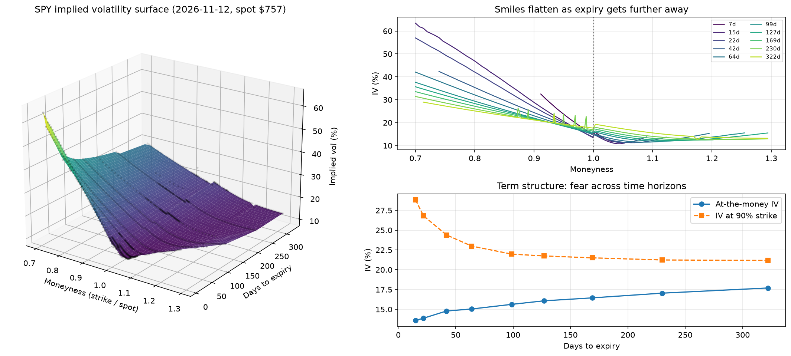
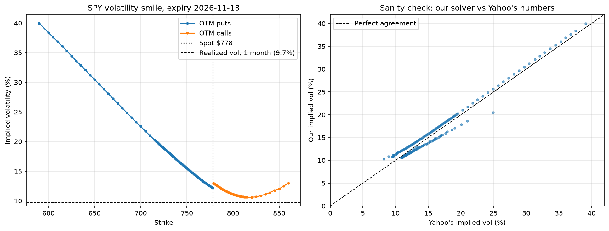
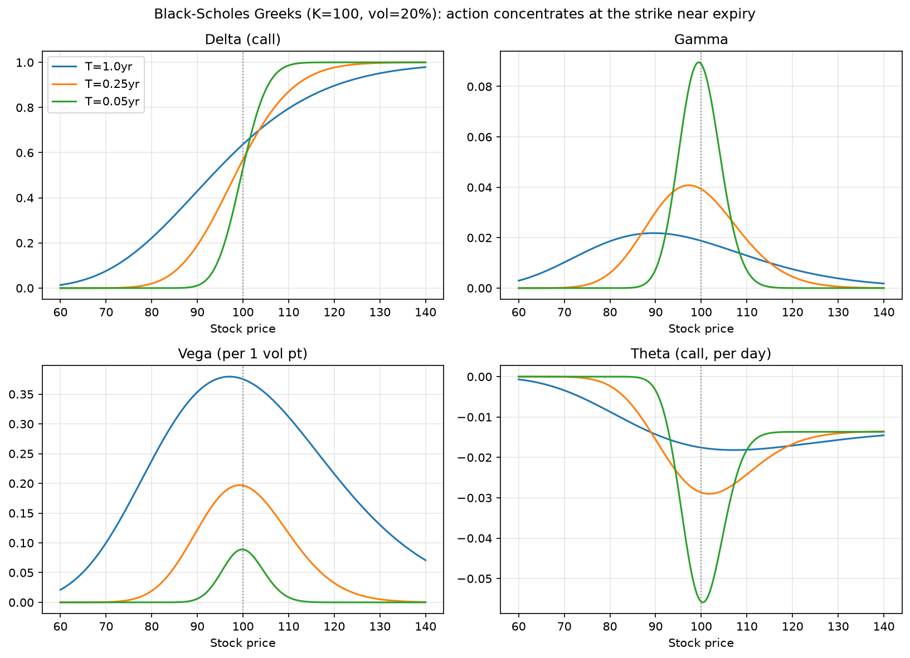

# Options Lab: Option Pricing Engine and Implied Volatility Surface

An options pricing and volatility analysis toolkit built from scratch in Python. It prices options three different ways, computes the Greeks, recovers implied volatility from **live US option prices**, and builds the full **implied volatility surface** for SPY.



## What's inside

| Module | What it does | Key idea |
|---|---|---|
| 1. Black-Scholes | Closed-form prices for European calls and puts | Put-call parity check to machine precision |
| 2. Greeks | Delta, gamma, vega, theta, rho | Every Greek verified against a finite-difference slope |
| 3. Binomial tree | Cox-Ross-Rubinstein tree, European and **American** options | Converges to Black-Scholes; prices the early-exercise premium |
| 4. Monte Carlo | Simulated price paths with confidence intervals | Antithetic variates; prices an Asian option that has no formula |
| 5. Implied volatility | Brent and Newton solvers applied to live SPY option chains | Reveals the volatility smile and skew in real data |
| 6. Volatility surface | Implied vol across strikes **and** expiries, in 3D | Skew and term-structure analysis; interactive 3D chart |

## Findings from live SPY data

**The volatility skew (Module 5).** For the November 2026 expiry, with SPY at about $778:



- Out-of-the-money puts at the $590 strike (about 24% below spot) traded at **~40% implied vol**, versus **~12.5%** at the money. The market charges more than three times as much volatility for crash protection.
- Calls show a smile, bottoming around the $815 strike and rising again further out, which points to fat tails on both sides.
- At-the-money implied vol (~12.5%) sat above one-month realized vol (9.7%). That gap is the **volatility risk premium** that option sellers collect.

**The surface (Module 6).** Across expiries, the smile is steepest for short-dated options and flattens as expiry lengthens. A 10% drop is an extreme event over a week but an ordinary one over a year. The at-the-money term structure shows whether near-term fear sits above or below long-term fear.



## How it's validated

The project has 50 automated tests (`python -m pytest`), including:

- Black-Scholes prices match textbook values, and put-call parity holds to about 1e-15.
- Each analytic Greek matches a numerical (finite-difference) derivative.
- The binomial tree converges to Black-Scholes, and an American call equals a European call when there are no dividends.
- Monte Carlo prices fall within their confidence intervals, and antithetic sampling reduces the error.
- The implied volatility solver recovers known volatilities exactly, including with dividends.

## Project structure

```
src/        the library: pricing models, Greeks, IV solver, market data, surface
scripts/    one runnable demo per module
tests/      pytest test suite
images/     charts produced by the scripts
data/       saved option-chain snapshots
```

## Quick start

```bash
python3 -m venv .venv
source .venv/bin/activate
pip install -r requirements.txt

python scripts/module1_demo.py          # Black-Scholes basics
python scripts/module5_implied_vol.py   # live SPY smile (needs internet)
python scripts/module6_vol_surface.py   # live 3D surface (needs internet)
python -m pytest                        # run all tests
```

Module 6 also writes an interactive 3D chart to `images/module6_surface_SPY.html`. Open it in a browser to rotate the surface.

## Limitations

- SPY options are American-style, but implied vols here use the European Black-Scholes model. Using only out-of-the-money options keeps the early-exercise effect small.
- The dividend yield is a constant assumption (1.2% for SPY), and the risk-free rate is the 13-week T-bill yield.
- Yahoo Finance data can be delayed. Outside market hours, the code falls back to last-traded prices, which can be stale.
- The surface is linearly interpolated between market quotes. No smoothing or arbitrage-free fitting model (such as SVI) is applied yet.

## Interactive dashboard

`app.py` is a Streamlit web app. Enter any US ticker to see its live volatility surface, smile and term structure, or price any option three ways with its Greeks.

```bash
python -m streamlit run app.py
```

If Yahoo Finance can't be reached, the dashboard falls back to the latest snapshot saved in `data/`.
